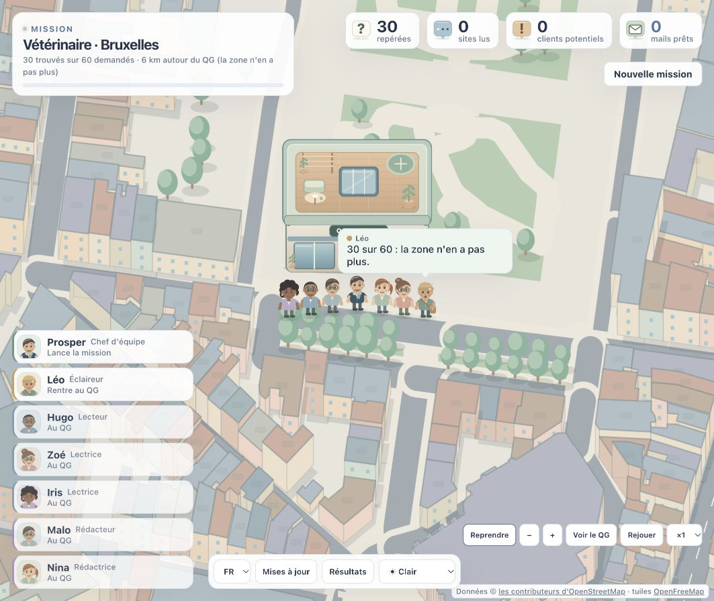

# Prosper et les prospects

Une équipe de sept personnages explore les commerces du **Benelux**, lit leurs sites et prépare des premiers contacts. Vous choisissez la ville, le métier et votre offre. Prosper coordonne Léo, Hugo, Zoé, Iris, Malo et Nina sur la carte réelle, dans une ville illustrée.

**Interface et mails en français, néerlandais et anglais. Aucun mail n’est envoyé par le logiciel.**

Adaptation du [QG des agents](https://github.com/devlikemasta/qg-des-agents), sous licence MIT. Le thème clair et nuit reprend les couleurs de [Oscar et les agents](https://github.com/renaud-bxl/oscar-et-les-agents), l’autre application de cette famille.



## Installer et démarrer

Prérequis : **Node.js 22.13 ou plus récent** et **Git**. Pour écrire des mails, connectez Claude Code ou Codex sur votre ordinateur. La collecte et l’analyse seules fonctionnent sans assistant de rédaction.

```sh
git clone https://github.com/renaud-bxl/prosper-et-les-prospects.git
cd prosper-et-les-prospects
npm ci
npm start
```

Le logiciel ouvre **http://127.0.0.1:5577**. Il n’écoute que sur votre ordinateur. Les lancements suivants demandent simplement `npm start` dans ce dossier. Sur macOS, `Lancer Prosper.command` propose le même démarrage ; sur Windows, utilisez `Lancer Prosper.cmd`.

## Première mission

1. Choisissez la langue de l’interface et le thème clair/nuit.
2. Cherchez une ville en Belgique, aux Pays-Bas ou au Luxembourg. Les variantes de noms sont reconnues, comme Bruxelles/Brussel et Anvers/Antwerpen.
3. Sélectionnez un métier, un rayon et un nombre de commerces. Commencez par cinq.
4. Choisissez **Lecture seule**, **Claude Code** ou **Codex**. Pour les mails, renseignez votre offre et votre signature. La langue des mails est indépendante de celle de l’interface ; le mode automatique suit la langue déclarée par le site, sinon le français.
5. Lancez la mission. Le scout découvre les commerces ; les lecteurs empruntent les rues et entrent dans les bâtiments. Cliquez sur un commerce pour consulter contacts, observations et score.
6. À la fin, la fenêtre de résultats s’ouvre sur toute la surface disponible. Les clients potentiels, leurs contacts et leurs brouillons y sont réunis. En mode analyse seule, renseignez votre offre et votre signature dans cette fenêtre puis préparez les mails manquants, sans relancer la recherche.
7. Relisez et corrigez chaque brouillon, puis validez ou refusez. L’envoi éventuel se fait depuis votre messagerie.

Les sites publics peuvent être incomplets ou inaccessibles. Les signaux sont des observations automatiques, à vérifier avant usage : l’absence d’un module détecté ne prouve pas l’absence du service. Les commerces sans contact public peuvent être écartés. Les données cartographiques dépendent d’OpenStreetMap et des services de tuiles publics.

## Claude Code, Codex et Cursor

| Usage | Prise en charge |
| --- | --- |
| Développer et lancer depuis Claude Code, Codex ou Cursor | Même projet Node.js, consignes partagées dans AGENTS.md et CLAUDE.md |
| Rédiger avec l’abonnement Claude | Claude Code connecté, commande `claude` |
| Rédiger avec l’accès Codex | Codex connecté, commande `codex` |
| Utiliser Cursor comme moteur de rédaction du serveur | Pas implémenté ; Cursor peut développer et démarrer l’application |
| Appeler directement le modèle OpenAI o1 par API | Pas implémenté ; o1 est signalé obsolète dans la [documentation OpenAI](https://developers.openai.com/api/docs/models/o1) |

Le champ modèle passe le nom au CLI choisi : sa disponibilité dépend du compte et du CLI. Une option inconnue produit une erreur visible, sans brouillon de remplacement. Aucune clé OpenAI n’est nécessaire pour les moteurs CLI. Le logiciel ne crée aucune clé et n’enregistre aucun identifiant de connexion.

Les pages des commerces sont des données non fiables. Les consignes de rédaction sont séparées de leurs extraits. Claude est appelé sans outils et sans configuration MCP ; Codex utilise un dossier isolé, une session éphémère et une lecture seule avec les principales surfaces d’outils désactivées. Ces CLI et leurs versions doivent être maintenus à jour. Les informations nécessaires au brouillon sont transmises au fournisseur de l’assistant choisi ; les fichiers locaux de missions ne sont pas publiés sur GitHub.

## Mises à jour en un clic

Pour une installation faite avec **git clone** sur la branche **main**, le logiciel vérifie le dépôt GitHub au démarrage puis périodiquement (cache de 30 minutes). Une notification présente les nouvelles modifications. Le bouton **Mettre à jour** :

- vérifie le dépôt d’origine et l’absence de mission active ou de modifications locales bloquantes ;
- prépare les dépendances et construit la nouvelle version dans un dossier isolé ;
- applique uniquement une avance directe de l’historique Git ;
- redémarre le serveur, puis recharge l’interface après vérification.

`config.json`, `.env` et `data/` sont préservés. Une erreur de préparation conserve la version actuelle ; un échec de redémarrage déclenche la restauration prévue. Une copie ZIP sans Git ne bénéficie pas des mises à jour automatiques. Une modification locale du code doit être résolue avant de mettre à jour. La mise à jour n’installe pas Node.js, Git ou les assistants à votre place.

Pour publier une modification destinée aux installations existantes, testez et construisez le projet, puis poussez les changements sur `main`. Les installations ouvertes détectent le nouveau commit ; les autres le détectent au prochain lancement. Aucun service de notification ne fonctionne quand le logiciel est fermé.

## Données et configuration

- `config.json` : votre offre et les derniers réglages, créé depuis `config.example.json` au premier démarrage.
- `data/agents.db` : missions, contacts, scores, brouillons et décisions dans une base SQLite locale.
- `data/overpass` et `data/tuiles` : cache des réponses publiques.
- `.env` : seulement la clé Google Maps facultative si vous choisissez cette intégration ; modèle fourni dans `.env.example`.

Ces chemins sont ignorés par Git. Ne publiez jamais votre configuration personnelle, votre base de contacts ou vos clés. Aucune intégration Gmail, SMTP ou d’envoi de masse n’est présente.

## Développement et validation

```sh
npm run dev
npm test
npm run build
```

Le serveur reste sur `127.0.0.1:5577`. Les tests utilisent des réponses HTTP, CLI et dépôts Git de contrôle ; ils ne contactent pas des prospects et n’exécutent pas de génération payante. Les moteurs Claude Code et Codex ont aussi produit chacun un brouillon de validation sur un exemple fictif, sans envoi. Les aides CLI sont vérifiées sur les versions installées pendant le développement ; l’authentification du compte reste propre à chaque utilisateur.

Le sous-dossier `site/` contient la page de présentation statique. Les contrôles clavier de la scène : `N` change la lumière, `R` rejoue, `C` recentre le réalisateur ; la molette et le glisser déplacent la caméra. `?cinema` rejoue une mission enregistrée en version cinéma.

## Sources et licences

- Code de départ : [devlikemasta/qg-des-agents](https://github.com/devlikemasta/qg-des-agents), commit `c262a413544b6c6ed80d4739e100d87b8ac26e34`, MIT ; copyright original conservé dans LICENSE.
- Explication du fonctionnement : [guide VibesMoney](https://vibesmoney.com/guides/clients-agents-ia). La vidéo transmise a servi de référence de travail ; elle n’est pas redistribuée dans ce dépôt.
- Thème : [Oscar et les agents](https://github.com/renaud-bxl/oscar-et-les-agents).
- Données : © contributeurs [OpenStreetMap](https://www.openstreetmap.org/copyright), ODbL ; tuiles [OpenFreeMap](https://openfreemap.org) ; [GeoNames](https://www.geonames.org), CC BY 4.0 ; contours Natural Earth, domaine public.
- Polices Pixelify Sans et Plus Jakarta Sans, OFL.

La liste de villes contient **1 181 villes d’au moins 5 000 habitants**, issues de GeoNames (686 BE, 476 NL, 19 LU), hors quartiers, avec alias officiels. Pour la régénérer, télécharger les fichiers GeoNames `cities5000.txt` et `admin1CodesASCII.txt` dans un dossier local puis lancer `node scripts/carte-donnees.mjs --geonames=/chemin/du/dossier`.
